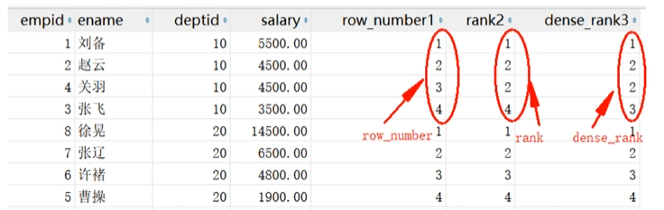

# 介绍

MySQL 函数是数据库内置的预定义功能模块，用于在 SQL 语句中对数据执行特定的计算、转换或判断操作。函数接收零个或多个参数，执行后返回一个结果值。函数可以嵌套调用，也可以在 `SELECT`、`WHERE`、`HAVING`、`ORDER BY` 等子句中自由使用。

函数必须通过 `SELECT` 语句调用来获取返回值。

```sql
SELECT 函数名(参数列表);
```

# 函数分类总览

MySQL 内置函数按功能可分为以下几大类：

1. 字符串函数：处理文本数据（拼接、截取、替换、大小写转换等）。
2. 数学函数：执行数值计算（四舍五入、取整、取余、幂运算等）。
3. 日期和时间函数：处理日期时间数据（获取当前时间、日期加减、格式化等）。
4. 聚合函数：对多行数据进行统计计算（求和、平均值、最大值、计数等）。
5. 条件/流程控制函数：实现条件判断逻辑（`IF`、`CASE`、`IFNULL` 等）。
6. 类型转换函数：在不同数据类型之间进行转换（`CAST`、`CONVERT`）。

# 字符串函数

字符串函数用于对 `CHAR`、`VARCHAR` 等文本类型的数据进行处理。

| 函数                                          | 作用                                              | 示例                                              |
| --------------------------------------------- | ------------------------------------------------- | ------------------------------------------------- |
| `CONCAT(str1, str2, ...)`                     | 连接多个字符串                                    | `CONCAT('Hello', ' ', 'World')` → `'Hello World'` |
| `SUBSTRING(str, start, length)`               | 从指定位置截取指定长度的子串（起始位置从 1 开始） | `SUBSTRING('MySQL', 1, 2)` → `'My'`               |
| `LENGTH(str)`                                 | 返回字符串的字节长度                              | `LENGTH('hello')` → `5`                           |
| `CHAR_LENGTH(str)`                            | 返回字符串的字符数（一个汉字算一个字符）          | `CHAR_LENGTH('你好')` → `2`                       |
| `UPPER(str)` / `LOWER(str)`                   | 转换为大写 / 小写                                 | `UPPER('abc')` → `'ABC'`                          |
| `TRIM(str)`                                   | 去除首尾空格                                      | `TRIM('  hi  ')` → `'hi'`                         |
| `REPLACE(str, from_str, to_str)`              | 将字符串中的指定子串替换为新子串                  | `REPLACE('hello', 'll', 'xx')` → `'hexxo'`        |
| `LEFT(str, length)` / `RIGHT(str, length)`    | 从左侧 / 右侧截取指定个数的字符                   | `LEFT('MySQL', 2)` → `'My'`                       |
| `LPAD(str, len, pad)` / `RPAD(str, len, pad)` | 在左侧 / 右侧填充字符至指定长度                   | `LPAD('5', 3, '0')` → `'005'`                     |
| `INSTR(str, substr)`                          | 返回子串在字符串中首次出现的位置，不存在则返回 0  | `INSTR('hello', 'll')` → `3`                      |
| `REVERSE(str)`                                | 反转字符串                                        | `REVERSE('abc')` → `'cba'`                        |

> `LENGTH()` 返回的是字节数，在 UTF-8 编码下，一个汉字占 3 个字节。
>
> 若需要统计字符数，应使用 `CHAR_LENGTH()`。

# 数学函数

数学函数用于对数值类型的数据执行算术运算。

| 函数                                           | 作用                                          | 示例                           |
| ---------------------------------------------- | --------------------------------------------- | ------------------------------ |
| `ABS(x)`                                       | 返回绝对值                                    | `ABS(-5)` → `5`                |
| `ROUND(x, d)`                                  | 四舍五入到 d 位小数                           | `ROUND(3.1415, 2)` → `3.14`    |
| `CEIL(x)` / `CEILING(x)`                       | 向上取整（返回大于等于该数的最小整数）        | `CEIL(3.2)` → `4`              |
| `FLOOR(x)`                                     | 向下取整（返回小于等于该数的最大整数）        | `FLOOR(3.9)` → `3`             |
| `TRUNCATE(x, d)`                               | 截断小数至 d 位（不四舍五入）                 | `TRUNCATE(3.1415, 2)` → `3.14` |
| `MOD(x, y)`                                    | 取余数                                        | `MOD(10, 3)` → `1`             |
| `POW(x, y)` / `POWER(x, y)`                    | 幂运算（x 的 y 次方）                         | `POW(2, 3)` → `8`              |
| `SQRT(x)`                                      | 平方根（负数返回 `NULL`）                     | `SQRT(16)` → `4`               |
| `RAND()`                                       | 生成 0 到 1 之间的随机浮点数                  | `RAND()` → `0.5794`            |
| `SIGN(x)`                                      | 返回符号（正数返回 1，负数返回 -1，零返回 0） | `SIGN(-10)` → `-1`             |
| `GREATEST(v1, v2, ...)` / `LEAST(v1, v2, ...)` | 返回参数列表中的最大值 / 最小值               | `GREATEST(3, 5, 2)` → `5`      |

> `ROUND()` 比 `TRUNCATE()` 消耗更多计算资源。`RAND()` 在大数据量排序场景下性能较差。

# 日期和时间函数

日期和时间函数用于处理 `DATE`、`DATETIME`、`TIMESTAMP` 等时间类型的数据。

| 函数                                           | 作用                                                    | 示例                                                     |
| ---------------------------------------------- | ------------------------------------------------------- | -------------------------------------------------------- |
| `NOW()`                                        | 返回当前日期和时间                                      | `NOW()` → `'2026-08-28 18:00:00'`                        |
| `CURDATE()`                                    | 返回当前日期（不含时间）                                | `CURDATE()` → `'2026-08-28'`                             |
| `CURTIME()`                                    | 返回当前时间（不含日期）                                | `CURTIME()` → `'18:00:00'`                               |
| `YEAR(date)` / `MONTH(date)` / `DAY(date)`     | 提取年 / 月 / 日                                        | `YEAR('2026-08-28')` → `2026`                            |
| `HOUR(time)` / `MINUTE(time)` / `SECOND(time)` | 提取时 / 分 / 秒                                        | `HOUR('18:30:45')` → `18`                                |
| `DATE_ADD(date, INTERVAL expr unit)`           | 日期加法                                                | `DATE_ADD(NOW(), INTERVAL 7 DAY)`                        |
| `DATE_SUB(date, INTERVAL expr unit)`           | 日期减法                                                | `DATE_SUB(NOW(), INTERVAL 1 MONTH)`                      |
| `DATEDIFF(date1, date2)`                       | 计算两个日期之间的天数差（date1 - date2）               | `DATEDIFF('2026-08-28', '2026-08-01')` → `27`            |
| `TIMESTAMPDIFF(unit, start, end)`              | 按指定单位计算时间差（支持 `YEAR`、`MONTH`、`HOUR` 等） | `TIMESTAMPDIFF(MONTH, '2026-01-01', '2026-08-28')` → `7` |
| `DATE_FORMAT(date, format)`                    | 将日期格式化为指定字符串                                | `DATE_FORMAT(NOW(), '%Y/%m/%d')` → `'2026/08/28'`        |
| `STR_TO_DATE(str, format)`                     | 将字符串按指定格式转换为日期类型                        | `STR_TO_DATE('2026-08-28', '%Y-%m-%d')`                  |
| `DAYOFWEEK(date)`                              | 返回星期几（1 = 星期日，7 = 星期六）                    | `DAYOFWEEK('2026-08-28')` → `6`                          |
| `QUARTER(date)`                                | 返回日期所在的季度（1~4）                               | `QUARTER('2026-08-28')` → `3`                            |
| `LAST_DAY(date)`                               | 返回该日期所在月份的最后一天                            | `LAST_DAY('2026-02-15')` → `'2026-02-28'`                |

> `NOW()` 在同一条 SQL 语句中返回的值是固定的，而 `SYSDATE()` 每次调用时都会重新获取系统时间。

# 聚合函数

聚合函数对多行数据执行计算，返回单个汇总值。聚合函数通常与 `GROUP BY` 子句配合使用。

| 函数                 | 作用                                           | 示例                                                   |
| -------------------- | ---------------------------------------------- | ------------------------------------------------------ |
| `COUNT(*)`           | 统计所有行数（包含 `NULL` 行）                 | `SELECT COUNT(*) FROM employees;`                      |
| `COUNT(列名)`        | 统计该列非 `NULL` 值的行数                     | `SELECT COUNT(phone) FROM employees;`                  |
| `SUM(列名)`          | 计算数值列的总和（自动忽略 `NULL`）            | `SELECT SUM(salary) FROM employees;`                   |
| `AVG(列名)`          | 计算数值列的平均值（自动忽略 `NULL`）          | `SELECT AVG(salary) FROM employees;`                   |
| `MAX(列名)`          | 返回最大值（支持数值、日期、字符串）           | `SELECT MAX(salary) FROM employees;`                   |
| `MIN(列名)`          | 返回最小值（支持数值、日期、字符串）           | `SELECT MIN(salary) FROM employees;`                   |
| `GROUP_CONCAT(列名)` | 将同一组内的值拼接为一个字符串（默认逗号分隔） | `SELECT GROUP_CONCAT(name SEPARATOR ', ') FROM users;` |

> 1. `SUM()`、`AVG()` 仅适用于数值类型。`MAX()`、`MIN()`、`COUNT()` 可处理任意类型。
> 2. 所有聚合函数（除 `COUNT(*)` 外）都会自动忽略 `NULL` 值。
> 3. 与聚合函数一同查询的非聚合字段，必须出现在 `GROUP BY` 子句中。
> 4. 对聚合结果进行过滤时，需使用 `HAVING` 子句，而非 `WHERE` 子句。

# 条件/流程控制函数

条件函数用于在查询中实现分支判断逻辑。

## `IF()` 函数

类似三目运算符，根据条件返回两个值之一。

```sql
IF(条件, 条件为真时的值, 条件为假时的值)
```

示例：

```sql
SELECT name, score, IF(score >= 60, '及格', '不及格') AS 等级 FROM students;
```

## `CASE` 表达式

支持多条件分支判断，有两种写法。

### 等值匹配

```sql
CASE 字段
    WHEN 值1 THEN 结果1
    WHEN 值2 THEN 结果2
    ELSE 默认结果
END
```

### 条件匹配

```sql
CASE
    WHEN 条件1 THEN 结果1
    WHEN 条件2 THEN 结果2
    ELSE 默认结果
END
```

## 空值

1. `IFNULL(expr1, expr2)`

   若 `expr1` 为 `NULL`，则返回 `expr2`，否则返回 `expr1`。

2. `COALESCE(expr1, expr2, ...)`

   返回参数列表中第一个非 `NULL` 的值。

```sql
SELECT IFNULL(phone, '未填写') FROM users;
SELECT COALESCE(phone, email, '无联系方式') FROM users;
```

# 类型转换函数

类型转换函数用于将数据从一种类型转换为另一种类型。

| 函数        | 语法                  | 说明                                  |
| ----------- | --------------------- | ------------------------------------- |
| `CAST()`    | `CAST(expr AS type)`  | 标准 SQL 语法，将表达式转换为指定类型 |
| `CONVERT()` | `CONVERT(expr, type)` | MySQL 扩展语法，功能与 `CAST()` 类似  |

常用目标类型包括：`SIGNED`（有符号整数）、`UNSIGNED`（无符号整数）、`DECIMAL(M,D)`（定点数）、`DATE`（日期）、`DATETIME`（日期时间）、`CHAR`（字符）等。

```sql
SELECT CAST('2026-08-28' AS DATE);
SELECT CONVERT(3.14, SIGNED);
```

# 其他常用函数

| 函数                     | 作用                                               |
| ------------------------ | -------------------------------------------------- |
| `VERSION()`              | 返回当前 MySQL 服务器版本号                        |
| `DATABASE()`             | 返回当前正在使用的数据库名称                       |
| `USER()`                 | 返回当前连接的用户名和主机名                       |
| `MD5(str)`               | 返回字符串的 MD5 哈希值（32 位，不可逆）           |
| `SHA2(str, hash_length)` | 返回字符串的 SHA-2 哈希值（推荐替代 MD5）          |
| `UUID()`                 | 生成一个全局唯一的 UUID 值                         |
| `NULLIF(expr1, expr2)`   | 若 `expr1 = expr2` 则返回 `NULL`，否则返回 `expr1` |

# 函数嵌套与组合

MySQL 函数支持多层嵌套调用，内层函数的返回值可以作为外层函数的参数。

```sql
-- 将姓名的首字母转为大写，其余转为小写，再与姓氏拼接
SELECT CONCAT(
    UPPER(SUBSTRING(last_name, 1, 1)),
    LOWER(SUBSTRING(last_name, 2))
) AS formatted_name
FROM employees;

-- 将平均薪资四舍五入到千位
SELECT ROUND(AVG(salary), -3) AS avg_salary_rounded
FROM employees;
```

# NULL 值对函数的影响

1. 任何包含 `NULL` 的算术表达式，结果均为 `NULL`。
2. 聚合函数（除 `COUNT(*)` 外）会自动忽略 `NULL` 值。
3. 字符串函数中，若参数为 `NULL`，返回值通常也是 `NULL`。
4. 使用 `IFNULL()` 或 `COALESCE()` 可以在查询时将 `NULL` 替换为指定的默认值，避免计算异常。

# 窗口函数

## 介绍

MySQL8以上的新特性，主要用于窗口排名。

```sql
# key word :partition by & order by
<开窗函数> over ([partition by <分组用列清单>]
                 order by <排序用列清单> [asc | desc])
                 
select *,
	开窗函数() over (
        [partition by 分组字段]
        order by 排序字段 [asc | desc]
    ) as 别名
	from ...
```

1. 本质定义

   窗口函数相当于给表**新增 1 列**，至于新增的是什么内容，取决于和什么函数一起使用。

2. 分组逻辑（PARTITION BY）

   - **如果不写** `partition by`：则统计的是**全表数据**。
   - **如果写了** `partition by`：则统计的是**组内的数据**。

3. 排序与范围逻辑（ORDER BY）

   - **如果不写** `order by`：则统计的是组内**所有的数据**。
   - **如果写了** `order by`：则统计的是组内从**第一行，截止到当前行的数据**（即累积计算）。

4. 别名

   建议写上，不然会以函数和over作为列名。

> - 这里只是一部分窗口函数。
> - 使用的时候记得加上`()`。

## 排名函数

- `row_number:` 不管排名是否有相同的，都按照顺序 1, 2, 3... n。
- `rank`: 排名相同的名次一样，同一排名有几个，后面排名就会跳过几次。
- `dense_rank`: 排名相同的名次一样，且后面名次不跳跃。

